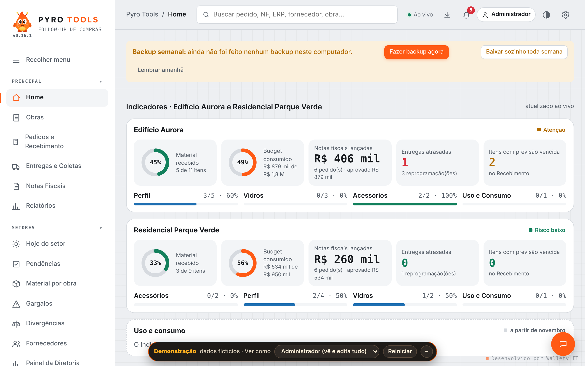
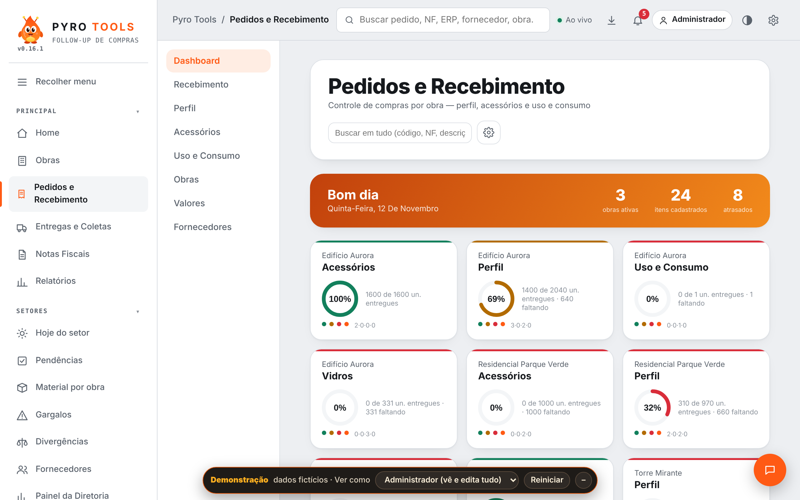
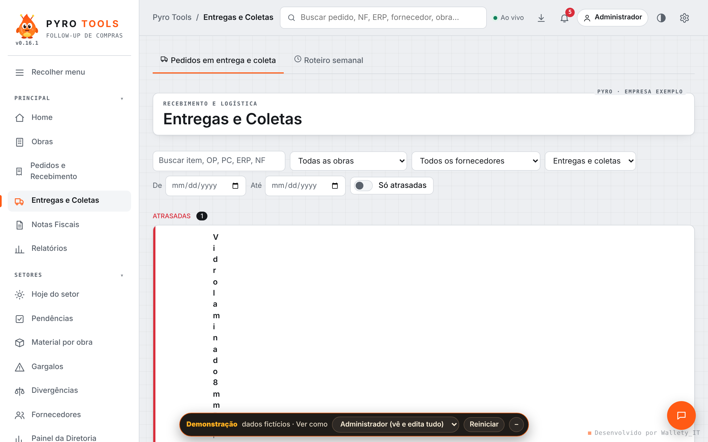
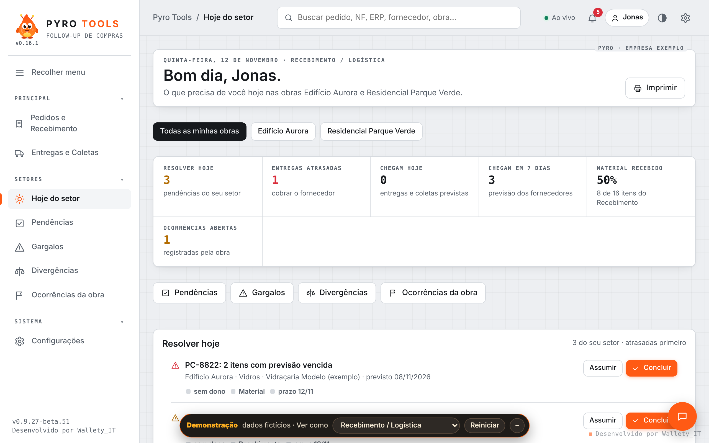

# 🔥 Pyro Tools

**Sistema web para acompanhamento de compras: pedidos, recebimento, entregas e coletas e notas fiscais, com acesso por setor e dados em tempo real.**


> ⚠️ Esta é a **versão de portfólio**. Obras, fornecedores, pessoas, pedidos e valores são **fictícios**. Nenhum dado, nome ou configuração de empresa real está neste repositório.

---

## 📸 Demonstração


*Home: indicadores por obra (material recebido, budget, notas e atrasos).*


*Pedidos e Recebimento: o que já chegou e o que falta, por obra e categoria.*


*Entregas e Coletas: atrasos, reprogramações e registro de chegada.*


*Hoje do setor: cada setor vê só as páginas e as obras liberadas para ele.*

🔗 **Demo online:** <!-- PREENCHER: link da demo depois de publicar (veja docs/publicar-a-demo.md) -->

A demonstração abre direto, **sem login**. Na faixa de baixo, o seletor **Ver como** troca o setor (Administrador, Compras, Recebimento, PCP, Obras, Projeto, Diretoria, Consulta) e o botão **Reiniciar** volta os dados ao começo.

---

## 💡 Por que eu criei

Trabalho na área de compras de uma empresa que fornece para obras da construção civil. O acompanhamento dos pedidos era feito em planilhas e quadros separados, e isso gerava problemas no dia a dia:

- A mesma informação era digitada em mais de um lugar.
- Cada setor consultava uma fonte diferente e nem sempre atualizada.
- Para saber o que já tinha chegado, era preciso perguntar para alguém.
- Quem recebia o material tinha dificuldade com a ferramenta usada e precisava de uma lista simples, que pudesse ser impressa.

Resolvi construir uma ferramenta única, em que um registro feito em uma tela aparece em todas as outras, e cada setor enxerga apenas o que precisa.

---

## ⚙️ O que o sistema faz

| Módulo | Função |
|---|---|
| **Home** | Indicadores por obra: material recebido, budget consumido, notas e atrasos |
| **Obras** | Pedidos por fase (lote) e categoria, com budget do contrato e por categoria |
| **Pedidos e Recebimento** | Item por item do que foi pedido e do que chegou, com importação de planilha e Excel |
| **Entregas e Coletas** | Previsões, reprogramações com motivo, cobrança do fornecedor e registro de chegada |
| **Roteiro semanal** | Calendário de entregas e coletas da Logística, com lista para impressão |
| **Notas Fiscais** | Controle das notas ligadas aos pedidos, do recebimento ao pagamento |
| **Páginas dos setores** | Hoje do setor, Pendências, Material por obra, Gargalos, Divergências, Ocorrências |
| **Diretoria** | Painel com risco em semáforo, aprovação de cotações e indicadores de compras |
| **Fornecedores** | Pontualidade e avaliação (IQF) de cada fornecedor |
| **Configurações** | Usuários, páginas por setor, obras liberadas, auditoria, backup e lixeira |

**Controle de acesso por setor:** cada usuário entra com e-mail e senha. O administrador define, para cada setor, quais páginas ficam ocultas, só para consulta ou com edição, e quais obras são liberadas.

---

## 🛠️ Tecnologias

| Camada | Tecnologia | Uso |
|---|---|---|
| Interface | HTML5, CSS3 | Telas, temas claro e escuro e layout para celular |
| Lógica | JavaScript (sem framework) | Regras de negócio, telas e integração com o banco |
| Banco de dados | Firebase Firestore | Dados compartilhados em tempo real |
| Login | Firebase Authentication | Acesso com e-mail e senha |
| Segurança | Firestore Security Rules | Permissão por setor e por obra conferida no servidor |
| Publicação | Firebase Hosting | Site no ar, sem instalar nada nos computadores |
| Versionamento | Git e GitHub | Histórico e versões (semântico) |

**Por que essas escolhas:** o sistema precisava funcionar no navegador, sem instalar programas nos computadores da empresa, e com todos vendo os mesmos dados ao mesmo tempo. O Firebase atende a isso sem exigir um servidor próprio.

---

## 🧱 Como estruturei

```
/
├── public/                    # o site
│   ├── index.html             # Pyro Tools: telas principais e painel de Recebimento
│   ├── entregas.html          # Roteiro semanal de entregas e coletas
│   ├── fb-bridge.js           # ponte com o Firebase: login, setores e permissões
│   ├── firebase-config.js     # configuração (modo demonstração ou projeto Firebase)
│   ├── demo-local.js          # modo demonstração: banco fictício no navegador
│   ├── sanitiza.js            # proteção contra HTML/script injetado (XSS)
│   ├── setores.js … setores6.js   # páginas dos setores, cotações, indicadores, auditoria
│   ├── layout.js, morcegos.js # menu e efeitos dos temas
│   ├── roteiro-fb.js          # liga o Roteiro ao mesmo banco e login
│   ├── sw.js, manifest.webmanifest, icons/   # instalação como aplicativo
│   └── versao.json            # versão publicada (aviso de versão nova)
├── firestore.rules            # regras de segurança do banco
├── firebase.json              # configuração de publicação
├── conferir.sh / publicar.sh  # conferência do pacote antes de publicar
├── docs/                      # prints e guia de publicação
├── CHANGELOG.md               # o que mudou em cada versão
└── README.md
```

**Decisões de estrutura:**

- **Um banco de dados único:** os painéis começaram separados e foram unificados para que um registro apareça em todas as telas.
- **Permissão por setor configurável:** as páginas liberadas ficam gravadas no banco, e o administrador liga ou desliga sem mexer no código.
- **Segurança no servidor, não só na tela:** as regras do Firestore conferem o setor e a obra a cada leitura e gravação.
- **Auditoria:** toda gravação gera um registro de quem fez, quando, e o antes e depois.
- **Conferência antes de publicar:** o `conferir.sh` checa arquivos, versão, regras e sintaxe e bloqueia a publicação se algo estiver errado.
- **Versões numeradas:** cada publicação tem versão e registro no [CHANGELOG.md](CHANGELOG.md).

### Modo demonstração

No uso real, o Pyro fala com o Firestore. Para o portfólio, o arquivo `demo-local.js` coloca no lugar um banco fictício que mora só no navegador de quem está vendo. Por isso a demo abre sem login, não custa nada e não expõe nenhum banco na internet. Nesse modo as permissões valem só na tela, porque não existe servidor; as regras reais estão em `firestore.rules`.

---

## 🤝 Como foi construído: meu papel e o uso de IA

Sou estudante de Análise e Desenvolvimento de Sistemas e construí o Pyro Tools **com apoio de inteligência artificial (Claude) na escrita do código**. Prefiro deixar isso claro e mostrar exatamente qual foi a minha parte.

**O que eu fiz:**

- Identifiquei o problema e levantei os requisitos conversando com os setores.
- Defini as telas, as regras de negócio e os perfis de acesso.
- Escolhi a arquitetura (aplicação web com Firebase) e o modelo de permissões.
- Testei cada versão, registrei os erros e validei as correções.
- Publiquei o sistema e cuido das versões e da documentação.

**O que a IA fez:**

- Escreveu grande parte do código a partir das minhas especificações.
- Explicou trechos e alternativas quando eu precisei decidir entre caminhos.

**O que eu aprendi a fazer sozinho nesse processo:**

<!-- PREENCHER com exemplos reais seus. Ideias:
- uma alteração que você mesmo fez no código
- um erro da IA que você percebeu e como percebeu
- um trecho que você sabe explicar linha a linha
-->

Os testes que faço no sistema estão documentados em um repositório próprio: <!-- PREENCHER: link do repositório de QA -->

---

## 📈 Resultados no uso real

A versão original está em uso em uma empresa, por mais de um setor.

- **Uma fonte única de informação:** os setores consultam o mesmo painel em vez de pedir planilhas.
- **Menos retrabalho:** o registro é feito uma vez e aparece em todas as telas.
- **Consulta direta:** os setores acompanham os pedidos por conta própria, com acesso só de leitura quando é o caso.
- **Adoção mais fácil:** a lista de entregas e coletas pode ser impressa por quem prefere papel.

<!-- PREENCHER, se tiver números reais que possa divulgar: quantos setores usam, quantos usuários, quanto tempo economizado por dia. Não invente números. -->

---

## 🏢 Como pode ajudar outras empresas

O problema não é exclusivo de um ramo. Qualquer empresa que compra materiais para projetos ou obras e depende de vários setores (compras, recebimento, planejamento, fiscal) pode usar a mesma ideia:

- Centralizar o acompanhamento de pedidos em um só lugar.
- Dar a cada setor uma visão própria, sem expor o que não é dele.
- Funcionar no navegador, sem instalação e com baixo custo de infraestrutura.
- Adaptar fases, categorias, setores e obras pela tela de configurações.

---

## ▶️ Como executar

**Demonstração (sem Firebase):** sirva a pasta `public` com qualquer servidor de arquivos e abra no navegador.

```bash
cd public
python3 -m http.server 8000
# abra http://localhost:8000
```

**Uso real (com Firebase):** crie um projeto no [Firebase](https://firebase.google.com/) com Firestore, Authentication (e-mail e senha) e Hosting. Em `public/firebase-config.js`, troque `PYRO_DEMO` para `false` e preencha a configuração do projeto. Coloque o e-mail do administrador em `firebase-config.js` e em `firestore.rules`, o ID do projeto em `.firebaserc`, e publique com `bash publicar.sh`.

O passo a passo para publicar a demonstração está em [docs/publicar-a-demo.md](docs/publicar-a-demo.md).

---

## 🗂️ Versões

O projeto usa versionamento semântico. O histórico completo está no [CHANGELOG.md](CHANGELOG.md).

---

Desenvolvido por **Wesley Lemos** · 
[LinkedIn](https://www.linkedin.com/in/wesley-lemos-profissional) · [GitHub](https://github.com/Alswes)
